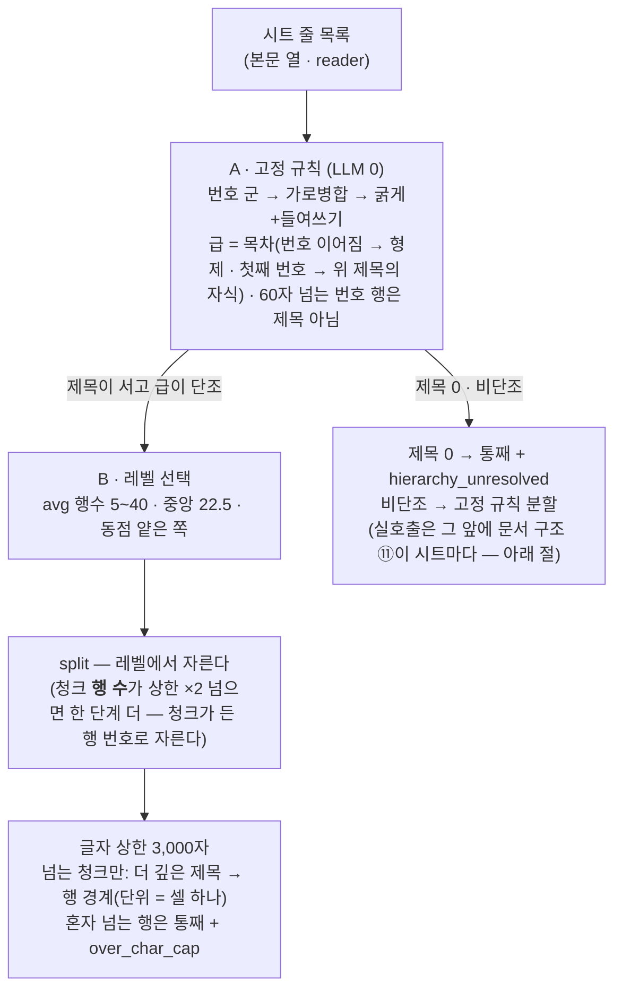

# 02 · 파싱과 추출 — 문서가 「형태」를 거쳐 「의미」가 되기까지

> ← `01_등록_흐름` · 다음 `03_구축`
> **무엇**: 확정된 어댑터로 문서를 파싱해 계약 JSON(형태)을 만들고, prose는 그 청크에서 추출 LLM이 의미(개체·관계 후보)를 뽑아 체크포인트로 남기기까지. **B48(파서 무판독·구조 지도 ⑦ 배선)·B46(일괄 투입) 반영본.**
> **정본**: 문서 2(계약 A) · 문서 6 §6.1~6.4 · 문서 4 §4.10(계약 B). 갈리면 명세가 이긴다.
> **실물**: `parser/` (reader·preflight·normalizer·tagger·validator·struct_map·pipeline·**form**) · `parser/adapters/` 3종 · `cli/parse.py` · `cli/extract.py` · `cli/ingest.py`. **B58 ③④ 반영**(고정 prose 어댑터 · 형태 판정).

> **자리(B78)**: 아래의 `review/`·`data/`·`parsed/`·`extract/`·`export/`는 전부 상태 루트 `$ONTO_HOME/` 아래다 — `review/`는 `registry/review/`(②등록), `data/`는 ③진실, `parsed/`·`extract/`·`struct_maps/`·`ingest_log/`는 `work/`(④). 정본은 문서 7 §7.1·§7.8, 운영자용은 `가이드/상태_폴더_가이드.md`.

## 경계선 하나 — 파서는 형태만, 추출부터 의미

```
 PARSER side (no layer vocabulary — A1)   │   CORE side (owns layer vocabulary)
                                          │
 raw ─▶ reader ─▶ adapter ─▶ normalizer   │   extract/{doc_id}.json ─▶ build
        ─▶ tagger ─▶ validator            │        ▲
        ─▶ parsed/{doc_id}.json  ─────────┼────────┘  (prose only)
                          contract A      │  contract B
```

파서가 층 어휘(카테고리·관계)를 알면 어댑터가 층에 묶여 **같은 어댑터가 두 층에서 돌 수 없다**. 그래서 "무엇이 개체인가"는 파서 밖에서 정한다 — table은 매칭 스키마가(등록 때), prose는 추출 LLM이(문서마다).

## 한 장 흐름

```mermaid
flowchart TD
  subgraph CLI["operator commands"]
    direction LR
    IF["run.py ingest-file / ingest-dir<br/>doc_id = filename stem · fingerprint scan picks doc_type"]
    PR["run.py parse run adapter doc [--doc-id X]<br/>doc_id = filename stem (B51)"]
    EXC["python -m cli.extract parsed.json<br/>(prose only)"]
    BL["run.py build parsed.json"]
    IF -. "calls in order" .-> PR -. "" .-> EXC -. "" .-> BL
  end

  subgraph INJ["cli/parse.py injections()  (B48)"]
    J["llm.image_summarizer() · llm.coord_picker() · llm.struct_mapper()<br/>live → functions · mock → None<br/>live + any None → NotConfigured"]
  end

  subgraph PARSER["parser — FORM  (pipeline.parse)"]
    direction TB
    RD["① reader.read<br/>xlsx cells (empty cells skipped) · pptx shapes · docx"]
    PF["② preflight.check<br/>table: header_row ↔ header_labels exact<br/>prose: fingerprint (title_row · max_col) or split signals<br/>mismatch → adapter_mismatch · document stops"]
    AD["③ adapter.extract(raw, struct_map_fn)<br/>pure function · no LLM · calls normalizer"]
    SM["🤖 ⑦ struct map (prose, structure-variable)<br/>map_structure → headings + level<br/>deterministic cut at chosen level (B43)<br/>kept in <상태>/work/struct_maps/"]
    NM["④ normalizer<br/>expand_merged · resolve_ditto(marks=None → no ditto, B76) · split_multi<br/>cells are read via skeleton helper only (rule 11)"]
    IM["🤖 ④ image summary<br/>summarize or fixed string"]
    TG["⑤ tagger<br/>coord_from_section → tag (closed list exact match)<br/>🤖 ⑨ pick_coord if injected — once per distinct surface · cap --coord-llm (B69)"]
    VA["⑥ validator<br/>contract A · hierarchy_unresolved → queue"]
    RD --> PF --> AD --> NM --> IM --> TG --> VA
    AD -. "prose" .-> SM -.-> AD
  end

  PJ["⚙ parsed/{doc_id}.json<br/>envelope: doc_id · doc_type · payload_kind · adapter_version · source_path<br/>table: records[]  ·  prose: chunks[] {text, section, source_locator, meta, image_ref, process_ref}"]
  VA --> PJ

  subgraph EXT["extract — MEANING · prose only  (cli.extract → core.extract)"]
    direction TB
    ING["ingest(env) — chunk ids computed (§7.2)<br/>no graph write"]
    CF["cfg = layers/{layer}/config.json<br/>categories · relations"]
    AC["attach_candidates(process_ref)<br/>skeleton nodes under the coordinate"]
    EL["🤖 ① extract per chunk<br/>prompts/3.3_extract.md<br/>closed category · closed relation · attach_to"]
    EJ["⚙ extract/{doc_id}.json<br/>candidates[{chunk_id, entities[{surface,category}], relations[{src,rel,dst}], attach[]}]<br/>prompt_version · config_extract(추출 칸 해시)<br/>file exists = extracted · build reuses"]
    ING --> EL
    CF --> EL
    AC --> EL
    EL --> EJ
  end
  PJ -- "prose" --> ING
  PJ -- "table (schema decides meaning)" --> BL
  EJ --> BL

  J -.-> IM
  J -.-> TG
  J -.-> SM
  SK["📄 data/skeleton_closed_list.json<br/>snapshot — same file for parser and core"] --> TG
  SK --> AC

  classDef llm fill:#c7d2fe,stroke:#4338ca,color:#1e1b4b
  classDef asset fill:#bbf7d0,stroke:#15803d,color:#052e16
  classDef file fill:#e5e7eb,stroke:#374151
  class SM,IM,EL llm
  class SK asset
  class PJ,EJ file
```

## ⓪ 형태 판정 — table로 읽을까 prose로 읽을까 (B58 ④)

**doc_type 식별과 다른 판정이다.** 어느 어댑터인가(지문 스캔)가 아니라 **어느 갈래로 읽는가**를 정한다. 대상은 xlsx·csv이고 pptx·pdf는 포맷이 이미 prose를 함의한다.

**`parser/form.py` — import가 `__future__`·`re` 둘뿐이다.** 문서 1 C37의 「이 자리에 LLM을 두지 않는다」가 주석이 아니라 **모듈 경계로** 잠겨 있다: 어기려면 import를 늘려야 하고 그것은 diff에 보인다.

| 신호 | prose | 기권 | table |
|---|---|---|---|
| column count | ≤2 | 3–4 | ≥5 |
| min unique ratio | ≥0.9 | 0.5–0.9 | ≤0.5 |
| max column text share | ≥80% | 40–80% | ≤40% |
| indented cell share | ≥30% | 5–30% | ≤5% |
| numbered-pattern rows | ≥5 | 2–4 | ≤1 |

**찬성 ≥2 · 반대 0이면 자동, 그 외는 사람** + 신호값을 화면에. **AND가 아니고 가중치도 없다** — 신호가 서로 중복이라 AND는 하나가 흔들릴 때 나머지를 거부권으로 뒤집는다. **중간 구간의 기권이 장치의 핵심이다**(실측: `column_count` 문턱을 (2,5)→(2,3)으로 좁혀 기권을 없애자 prose 4표를 열 신호 하나가 뒤집어 사람으로 넘어갔다).

- 확인: `python run.py scan --form` — 판정표 한 장.
- **판정이 정해진 것을 갈아 끼우지 않는다.** 어댑터의 `payload_kind`와 어긋나면 **경고하고 지정대로 간다**([정정] 48) — 뒤집으면 사람의 `--doc-type`이 조용히 무시되고, 자동 라우팅은 `header_labels` 완전 일치라 어긋나면 형태 판정 쪽이 틀렸을 개연성이 크다. 안전망은 preflight다.
- **기록이 절반이다**: 신호값 5 + 투표 + 판정 + 자동 여부가 `doc_registry.json`의 `routing.form`에 남는다. 문턱 조정과 애매 구간 측정의 유일한 재료다.

## 파서 3단 + 2 — 순서대로

| Step | Module | Does | Fails how |
|---|---|---|---|
| ① | `reader` | 포맷별 원시 추출. **빈 셀은 읽지 않는다**(`reader.py:57`). pptx: 텍스트·표·차트·그룹·SmartArt·그림·노트, 시각 순서, 숨김 제외(B53) · pdf: 페이지 텍스트 + 렌더(PyMuPDF, B53) | ImportError는 지연 import로 격리 |
| ② | `preflight` | **양식 표류 감지.** table: `header_row` 행의 실물 헤더 ↔ `expects.header_labels` **완전 일치**(missing·extra 0). prose: 지문(`title_row`·`max_col`) 대조 또는 분할 신호 존재 | `adapter_mismatch` — **문서 단위 중단**, extract 안 돈다(C14) |
| ③ | `adapter.extract` | 어댑터 = 순수 함수. LLM 안 부름(하네스가 검사). prose 어댑터는 `struct_map_fn` 훅을 받아 구조 지도를 **코어에 위임**. **prose는 doc_type마다 만들지 않는다 — 포맷별 고정 기본 어댑터 셋**(`basic_ppt`·`basic_pdf`·`basic_prose_xlsx` — B58 ③): 어댑터가 분할하지 않는 이상 남는 일은 「줄 목록 + 계층 신호 읽기」뿐이고 그것은 doc_type이 아니라 **포맷**이 정한다. **prose 등록의 생성 LLM은 0회다** | 예외 → `parse_failure` |
| ⑦ | `struct_map` | **레벨은 인입마다 결정적 규칙이 고른다**([정정] 46 — 구판은 등록 때 상수로 박았다): `level_stats`의 레벨별 avg 행수에서 **목표 구간 [5,40] 안에 들고 구간 중앙에 가장 가까운 레벨.** 규칙이 못 정하는 계열만 **LLM이 제목 행·급을 판정**(`map_structure`)하고 **분할은 언제나 코드**다. `source: live/heuristic/kept` · `<상태>/work/struct_maps/`에 보존(자리는 `core/paths.py`가 파서에 주입). **무엇을 보고 골랐나가 기록된다**(B68): 프레임마다 `분할_기준`·`지도_출처` — 고정 산문 xlsx 어댑터는 `adapter:basic_prose_xlsx` · 신호 넷(번호 → 가로병합 → 굵게+들여쓰기 → 없음)의 헤딩 수, 지도 경로는 `구조 지도(LLM · 판본 n)`/`heuristic`. 두 경로 한 이름 — generate/status가 프레임당 한 줄, 뷰 레벨 선택 표에 「분할 기준」 열 | 예산 초과·판정 불가 → 평면 폴백 + `hierarchy_unresolved`(`case: flat_fallback`) · **구간 밖이면 최근접 레벨 + `hierarchy_unresolved`(`case: size_out_of_band`)** — 자동으로 지도 패스(LLM)로 넘기지 않는다([정정] 48) |
| ④ | `normalizer` | 병합 전개 · 상동(〃) 해소 · 복수값 분리 — **어댑터가 재구현하지 않는다**(규약 10) | |
| ④′ | `tagger.complete_images` | 이미지 요약 — 주입된 `summarize(ref, image=바이트, mime, context=슬라이드 맥락)` 또는 고정 문자열. **B53 전까지 실호출이 참조 문자열만 보냈다**(결함, §AJ) | 게이트웨이가 이미지를 못 받으면 `NotConfigured` |
| ⑤ | `tagger.tag` | 좌표 태깅 — 골격 닫힌 목록 **정확 일치**(미스면 영문 대소문자 2차 대조(`ids.fold_latin` — 라틴 글자만 접는다 · 가리키는 것이 하나일 때만 · 둘 이상이면 미스 + 로그 · `norm`은 그대로 · B96) — 맞으면 정확 일치로 센다 · 저장하는 `process_ref`는 원문 그대로). 미스면 값 보존 → 인입에서 `orphan_anchor` 큐. `pick_coord` 주입 시 LLM이 닫힌 목록 중 고름(⑨) — **묻는 단위는 표기**(B69: 목록 밖 표기 종수만큼, 같은 표기는 한 번 · null 답도 기억). **찾는 순서**(B101 ② · B107 ②): 골격 이름·별칭(사람 보증) → **좌표 학습 기록**(`data/coord_learned.json` — LLM이 전에 채택한 표기 · 표기 정확 대조 · 가리키는 골격 노드가 지금 목록에 있을 때만 · 적중은 LLM 0 · `meta.coord_tag_source=learned`) → **목록 밖 기억**(전에 null이라 답한 표기 — 기록 `목록밖`의 `list_version`이 지금 닫힌 목록의 판과 같으면 묻지 않는다 · LLM 0 · 행은 목록 밖 그대로 → `orphan_anchor` · 예고 `기억_종수`는 `묻는_종수`에서 빠진다) → LLM. **판 = 닫힌 목록 내용의 해시**(`tagger.list_version` — 노드 canonical · 별칭 · id·시각은 넣지 않는다: 재구축이 다시 심어도 같은 목록이면 같은 판 · 사람이 적는 `skeleton_version` 문자열이 아니다 — `ALIASES`만 더해도 바뀐다). 채택은 그 자리에서 기록에 남는다(출처 `LLM 좌표 학습` · 문서 · 시각 · 골격 판 · 내용 판) · null 답은 해소에 쓰지 않고 **새 공정 후보**(기록의 `목록밖` — `show learned` · 기억된 것도 보인다)로 · 기록은 좌표 층 이름이 있을 때만 읽고 쓴다(파서는 읽기·쓰기 함수를 주입받는다 — `paths.bind_parser` · 킷은 꺼짐) · 사람의 손은 `show learned`(목록) · `ops learn-promote`(골격 `ALIASES`로 → `bootstrap`) · `ops learn-reject`(채택을 지운다 · 채택이 없으면 그 표기의 목록 밖 기억(`list_version`)만 지운다 — 다음엔 다시 묻는다 · 후보는 남는다). 인입 · 재구축 · 등록 리허설이 이 함수 하나다. 호출 전 예고 줄(조각·정확 일치·표기 종수 · 목록 밖(기억) → 최대 n회) · 상한 `--coord-llm`(기본 100종, 초과분은 목록 밖 그대로) · 계획·결과는 `report["coord_tag"]` | |
| ⑥ | `validator` | 계약 A 검사 | 위반 → 문서 미인입 |

**파서에 「지금 mock인가」라는 질문이 없다**(B48). `cli/parse.py::injections()`가 함수 3종을 만들어 내려보내고, 파서는 **함수가 왔는가**만 본다. 실호출 모드에서 하나라도 None이면 조립 지점이 `NotConfigured`로 멈춘다.

## 리더 넷과 그림의 길 (B88)

| 포맷 | 리더 | 경계 | 기본 어댑터 | 그림 |
|---|---|---|---|---|
| `.xlsx`·`.csv` | `reader.read_xlsx`(openpyxl) · `read_csv` + **그림은 `parser/ooxml.xlsx_images`(zip)** | 시트 → 계층(번호 군 · 병합 · 굵게 · 문서 구조) | `basic_prose_xlsx` | `prose` 시트 그림만 — 앉은 행의 청크가 section·context |
| `.pptx` | `read_pptx`(python-pptx) | 슬라이드 = 추출 단위 · 표 · 차트 · 그림은 근거 청크 | `basic_ppt` | 그림 요약에 쪽 렌더 동봉 · 캡처는 추출에(아래 「PPT 한 덱이 지나는 길」) |
| `.pdf` | `read_pdf`(pymupdf) | 쪽 | `basic_pdf` | 쪽 텍스트가 context · 쪽 렌더 동봉 |
| `.docx` | **`parser/ooxml.read_docx`(zip + XML — 선택 의존 0)** | 문단이 행 → 개요 수준(스타일 상속) > 번호 군 > 굵게 → B87 엔진 | `basic_docx` | 앞 청크가 section·context |

그림은 **④ 경로 하나**를 탄다: 리더가 바이트를 `raw["_images"]`에만 싣고(계약 JSON에 바이트 0) → 어댑터가 placeholder 조각(`image_ref` · `section` · `context`) → 파이프라인이 `ref` 시트 그림을 빼고(`--no-images`면 전부 빼고 기록) → 모델이 안 받는 형식은 `render.to_png`(`soffice`)로 PNG, 못 바꾸면 그 그림만 건너뜀 + 사유 → 예고 `그림 요약 — 새 n장 → LLM ≤ n회(보존 재사용 m)` → `tagger.complete_images`(보존 재사용 · mock 고정 문자열). 쪽 렌더는 쪽이 있는 포맷(PPT·PDF)만. 옛 이진 형식(`.doc`·`.xls`·`.ppt`)은 선택 단계에서 「새 형식으로 저장해 다시」 문면으로 거부한다.


## PPT 한 덱이 지나는 길 (B125)

**필요한 것** — 전부 선택 의존이다(코어는 표준 라이브러리) · 목록의 정본은 `requirements.txt`.

| 무엇 | 하는 일 | 없으면 |
|---|---|---|
| `python-pptx`(+ `lxml`) | 슬라이드 · 상자 · 표 · 차트 · 그림 · SmartArt · 노트를 읽는다 | `.pptx`를 설치 문면으로 거부 |
| `PyMuPDF`(`import pymupdf` · 옛 판은 `fitz`) | PDF를 읽고 쪽을 PNG로 렌더한다(캡처 · 그림 요약의 쪽 맥락) | 실호출 PPT · PDF 인입은 사전 점검에서 멈춘다 · `.pdf`를 설치 문면으로 거부 |
| 캡처 길 하나 — LibreOffice `soffice`(Impress 포함 · pip가 아니다 · 찾기는 `render.find_soffice` 한 함수 — 지정 `SOFFICE_PATH` → PATH → 표준 설치 자리) 또는 같은 폴더 · 같은 이름의 더 최신 PDF(PowerPoint에서 저장) · PDF 문서는 PyMuPDF만 | PPTX → PDF(캡처의 재료) · `soffice`는 모델이 안 받는 그림 형식(WMF · EMF …) → PNG도 | 실호출 PPT · PDF 인입은 사전 점검에서 멈춘다(`--no-capture`면 캡처 없이 진행 · 기록) · 그 그림만 건너뜀 |
| 게이트웨이 그림 입력(`llm-check` ⑦ — 캡처 크기 1,600×900 한 장) | 캡처 · 그림 요약을 모델에 보낸다 | 실호출 PPT · PDF 인입은 박힌 그림이 없어도 사전 점검에서 멈춘다 — `--no-capture`(캡처만) · `--no-images`(그림 요약 · 캡처)면 진행 |

있는지는 `python doctor.py --env`가 잰다(`PPT 캡처 — 가능(길) / 불가(빠진 것)` — soffice는 실제 변환까지) · 판정은 `parser.render.capture_path` 한 함수(그림 요약의 쪽 렌더 · 추출 캡처 · 사전 점검 · 환경 점검이 같은 답).

**순서**

| 단계 | 누가 | 무엇 |
|---|---|---|
| 읽기 | `reader.read_pptx` — 규칙 | 상자를 **시각 순서**(위 → 왼쪽)로 · 그룹은 안까지 · 종류 일곱(제목 · 부제 — placeholder 종류 · 글 · 표 · 차트 · 그림 · SmartArt) · 표와 차트는 글로 푼다(형태 변환이지 의미 판정이 아니다) · 노트 · 레이아웃 이름 · 숨김 슬라이드는 표시만 하고 어댑터가 거른다 · 그림 바이트는 `raw["_images"]`에만 |
| 덱 구조 | 지점 ⑪(태그 `deck`) — 덱마다 1회 | 입력: 슬라이드마다 상자 글(상자당 300자 · placeholder 제목 표시 = 힌트) · 노트 앞 300자 · 표 · 차트 머리 160자 + 문서 좌표(힌트) + 골격 닫힌 목록 + 층 힌트 `prompts.structure` → 슬라이드마다 제목 · 구획 · 이어짐 · 다루는 공정(목록) · 언급 공정 · 개체 없음 + 덱 개요 · 코드는 검사만(제목은 그 슬라이드 글 안 · 공정은 골격 목록 안 · 이어짐은 앞 슬라이드) · 같은 파일 · 같은 판이면 LLM 0(`work/struct_maps/` 보존) · 사람 고침은 `@덱`(`--step`의 덱 구조 표) |
| 쪼개기 | `basic_ppt` — 규칙 | **추출 단위 = 슬라이드**(`meta.extract_unit`) · 본문이 `ppt_slide_chars`(3,000자) 이하면 본문 근거 청크 1 · 넘으면 구조 지도로 나누고 지도도 실패하면 통청크 + `hierarchy_unresolved` 큐 · 표 · 차트 · 그림은 각자 근거 청크(`S#-TB1` · `S#-CH1` · `S#-P1`) · 이어진 슬라이드는 앞 슬라이드의 경로 · 공정을 잇는다 · 「개체 없음」 슬라이드는 추출 0 |
| 그림 요약 | 지점 ④ | 그림 한 장 + 그 쪽 렌더(맥락) — 위 「그림의 길」 그대로 |
| 캡처 | 파이프라인 · 추출 | 조각에 보이는 쪽 번호(`meta.page_no` — 숨김을 뺀 순서) · 추출이 원본에서 문서마다 한 번 렌더한다: 같은 폴더 · 같은 이름의 더 최신 PDF → 없으면 `soffice` 변환 → PyMuPDF가 쪽마다 PNG(긴 변 1,600px) · 렌더 쪽 수와 보이는 쪽 수가 다르면 붙이지 않는다 · 길은 `capture_path`가 정한다(PDF 문서 · 옆 PDF는 `soffice` 없이) · 길이 없으면 실호출은 사전 점검에서 이미 멈췄다 — 문서 중간의 렌더 실패 · 쪽 수 불일치만 그 문서를 캡처 없이(추출 예고 위 `캡처 — 있음 n · 없음 m(사유)`) |
| 추출 | 지점 ① — 슬라이드마다 1회 | 맥락 줄(덱 개요 칸 포함) + 본문 + `[표 S#-TB1]` · `[차트 …]` · `[그림 요약 …]` + `[노트]` + 캡처 PNG · 개체는 그 표기 · 값 글자가 든 근거 청크로(없으면 본문 청크) · 값은 글자에서만(그림 요약 · 캡처의 값은 버림) · 청크 공정은 목록(부착 후보 = 목록 공정들의 하위 트리 합 · 다른 공정 가드 = 목록 전체의 계보 밖) · 언급 공정은 노드 0 + `about` 관련 링크 |

**저장하지 않는 것**: 그림 · 렌더 바이트(요약과 추출 결과만 남는다 — 문서 1 B16). 보존분(`work/struct_maps/<doc_id>.json`)은 덱 구조와 그림 요약이다.

## 시트 역할 — 두 모드 (파싱 앞 · 칸 3.1 관문 · 3.8 판정)

시트 여럿인 산문 엑셀은 파싱 **전에** 시트마다 역할(`prose`·`ref`·`skip`)이 선다 — 관문 한 벌 `cli/sheet_gate.py`(인입 · `parse run` · 등록 표본). 제안은 **두 벌**이다:

| 제안 | 무엇을 보나 | 자리 |
|---|---|---|
| 로직 | 모양(글자비·행·평균 길이 AND — `sheet_thresholds`) + **사전 적중**(렌즈 층 어휘 — 사전 표기 중 그 층 카테고리 노드 + 층 config `relevance_terms` — 가 시트에 몇 종 나오나 · 영문 대소문자 무시 · `sheet_min_hits` 미만이면 `ref`) · LLM 0 | `parser/form.py::sheet_table`(어휘는 주입 — 파서는 사전을 모른다) · `sheet_gate.lens_info` |
| LLM ⑩ | 시트 이름 + 앞 60행(행마다 80자 — `form.SHEET_SAMPLE_ROWS` · `SHEET_SAMPLE_CHARS`) + 렌즈 층 카테고리 정의문·관련어 → `prose`/`ref` + 이유 · mock은 로직과 같은 답(호출 0) · `--no-sheet-llm`이면 끔 | `core/llm/points.py::judge_sheet` · `prompts/3.8_sheet_role.md` |

**사람 지정(기본)**: 표에 두 열과 제안(같으면 그것 · 어긋나면 `ref` — 모르면 ref · 빈 시트만 `skip`)을 보이고 사람이 답한다 · 비대화형은 거부(LLM은 물을 때만 부른다). **자동**(`--sheets auto`): 같으면 그 역할 · 어긋나면 `ref` + 승격 후보. 기록 `registry/sheet_roles/<doc_id>.json` = `sheets`(최종) · `logic` · `llm` · `llm_reason` · `llm_by` · `promote` · `decided_by`(`gate`·`flag`·`auto`) — 역할 문자열(`--sheets "…"`)은 제안을 보지 않으므로 두 제안 키가 없다. 일치율은 `show dist sheets`.

## 산문 엑셀의 계층 — A 제목 판정 · B 레벨 선택 · 글자 상한 (B87)

산문 엑셀 분할은 두 판단이다 — **A. 어느 행이 제목이고 몇 급인가** · **B. 어느 급에서 자르나**. B는 원래 문서·시트마다였고(인입 때 계산), B87이 **A도 시트마다** 서게 했다.



| Knob | 자리 | 무엇 |
|---|---|---|
| 번호 군 · 짧은 행 · 목차 | `parser/struct_map.py::HEADING_FAMILIES` · `HEADING_MAX_CHARS`(60) · `parser/toc.py::number_levels()` | **목차**(판 `toc.TOC_VERSION`) — 열린 제목 더미를 한 줄씩: 같은 꼴 · 서수 +1이면 형제 · 그 꼴의 첫째 번호(`1.` · `가.` · `(1)` · `①`)면 맨 위 제목의 자식 · 둘 다 아니면 같은 꼴이 열린 자리의 형제(없으면 자식) · 서수는 `number_value()`(점 번호는 마지막 마디) · 점 번호는 제 깊이 · 첫 판에서 「바깥 꼴 아래에서 다시 시작」하는 꼴은 그 바깥 꼴 위로 올라가지 않는다 |
| 청크 경로 | `toc.toc_chains()` · `struct_map.split()`의 `section` | 청크마다 시트부터 **그 청크를 연 제목**까지의 목차 사슬 전체 — 자른 단의 청크는 연 제목 · 한 단계 더 · 글자 상한 · 형제 · 구간 조각은 첫 줄을 가진 제목 · 제목 줄은 제 청크(남의 꼬리 0) · 추출 맥락 줄의 `경로` |
| 비단조 판정 | `struct_map.monotonic_reasons()` | ⑦ 타당성 검사와 **같은 규칙**(한 벌) |
| 글자 상한 | `struct_map.CHUNK_MAX_CHARS`(3,000) · `cap_chars()` | 상한 이하 청크는 **바이트 그대로**(추출 체크포인트 재사용 — `doc_hash`가 청크 내용 키) · 조각마다 `meta.char_cap_from` |
| 행이 단위 (B89 ①) | `split()`이 청크마다 싣는 `_lines`(행 번호 · 셀 글) · `_resplit()` · `cap_chars()` · `_pack()` | 한 단계 더 쪼개기의 판정·자르기와 글자 상한이 **행**으로 센다 — 셀 안 줄바꿈이 행 수를 부풀리지 않고, 조각의 locator는 그 조각의 첫 행~끝 행이다(글로 행을 되찾지 않는다) · 행 목록 없는 청크는 `ValueError`(조용히 원래 locator를 붙이지 않는다) |
| 화면 | `print_split_notes()`(문서 구조 · 글자 상한) · `show doc`의 「계층」 | 고정 규칙으로 안 선 시트는 문서 구조(⑪ — 아래 절)가 세운다 |

## 추출 — prose의 「의미」 단계 (계약 B)

| | |
|---|---|
| **입력** | **맥락 줄 + 청크 텍스트**(`core/build/extract_ctx.with_context` — `[문서 · 공정 · 시트 · 경로]` · 포맷 전부 한 함수 · 엑셀은 제목이 있어도 시트명 · 공정 칸은 조각 좌표 또는 문서 좌표 · B102 ①) · 층 config의 `categories`·`relations` · 골격 부착 후보. **사전도 그래프도 안 본다**(§4.10-1 — 순서 의존 결함 실측 후 확정) |
| **LLM** | 지점 ①. `prompts/3.3_extract.md` — *"청크가 주제로 서술하는 개체만 · 닫힌 목록 밖이면 내지 않는다 · 애매하면 빼는 쪽"* |
| **출력** | `extract/{doc_id}.json` — 청크별 `entities[{surface, category, belongs_to: {name, category, from} \| null}]` · `relations[{src, rel, dst}]`. **표면형만** — 노드 id 없음. **소속 계약**(B102 ③ · 지시문 e-1.4): `belongs_to`는 「무엇의 일부 · 무엇의 특성」 — 이름은 부착 후보 · 본문 · 맥락 줄 · **제목 개체**(B115 ③ · 지시문 e-1.6 — `heading_candidates`)에서만(`from` = 본문 \| 경로 \| 시트 \| 공정 \| 제목) · 없으면 null · 경로·시트 이름은 개체 후보로 내지 않고 소속으로만. 옛 체크포인트의 `attach[{surface, attach_to}]`는 같은 뜻으로 읽는다(`core/build/belongs.belongs_of`). **다른 공정 이름**(B113 ① · 지시문 e-1.5 규약 10 — 지금 e-1.6): 청크 좌표가 아닌 공정의 이름은 개체로 내지 않고 `about`으로 — 개체로 와도 구축의 공통 자리(`Builder.resolve_at_home`)가 노드 0 · 관련 링크로 둔다. **빈칸 표시**(B113 ②): 개체 표기 · 소속 이름이 공통 config `null_markers`와 같으면 빈 값(개체 0 · 소속 null — 대장 판정 `blank`) — 표의 좌표 칸은 파싱(`parser/normalizer.blank_coords`)에서 비워 문서 좌표를 물려받는다 |
| **재사용 조건** | **문서 해시 · 어댑터 판 · 지시문 판 · 층 config 판**이 모두 같을 때(`extract.reuse_check` · 부분 파일도 같은 조건 · B102 ⑥) + **개요의 대상 제목**(B115 ③ — 넷째 소속 출처가 바뀌면 다시 뽑는다 · 대상이 없으면 키 없음이라 옛 체크포인트와 같다) — 다르면 다시 뽑고 예고 줄에 이유(「지시문 e-1.5 → e-1.6」 · 「개요 없음 → <해시>」) |
| **문서 개요** (B115 ① · 지점 ⑪) | 추출 **전** 문서당(렌즈마다) 한 번 — 입력은 **제목 계층만**(`core/build/outline.tree` — 조각의 시트 이름 + `meta.section_path`를 ` › `로 자른 사슬 · 구획 경로가 프레임 이름 그 자체면 제목이 아니다 · 엑셀 · Word · PDF · PPT 같은 함수 · PPT는 덱 › 구획 › 슬라이드 제목) + 층 닫힌 카테고리 · 정의문 · 본문 0. `prompts/3.3_outline.md`(o-1.0) — 제목마다 대상 `{name, category}` 또는 null(주제) · 부모는 제목 트리가 정한다. 대조(`outline._check`) — 이름은 제목 글자 안(라틴 대소문자 2차) · 카테고리는 닫힌 목록 안 · 빈칸 표시는 주제 · 밖이면 버림(결함 로그 「개요 — …」). 체크포인트 `extract/outline/<doc_id>[@렌즈].json`(추출 폴더 안 — 기본 fresh가 남긴다 · 재인입이 추출 체크포인트를 버려도 남는다) · 재사용 = 제목 계층 해시 · 지시문 판 · 층 config 판. mock은 힌트 `tests/fixtures/extract_hints/<doc_id>@outline.json`만(없으면 전부 주제 · 체크포인트 0). 소비부 — 추출 입력 `heading_candidates`(조각 위 제목 개체 · 가까운 것부터 — 넷째 소속 출처 `제목`) · 제목 개체 노드(`core/build/heading.land`) · 폴백 사슬 · 연결 보강의 후보 범위 |
| **정지점** | **파일 존재 = 추출 완료.** `build`는 있으면 재사용(`[추출 체크포인트 재사용]`), `cli.extract --force`로 재생성. 재인입에서 청크가 바뀌면 `invalidate`(부분 파일도) |
| **이어 쓰기** (B97 ③) | 추출 중에는 청크가 끝날 때마다 **부분 파일** `extract/<doc_id>[@렌즈].partial.jsonl`에 줄로 덧붙인다(첫 줄 = 재사용 조건 문서 해시·어댑터 판·렌즈 · flush+fsync · 끊긴 마지막 줄은 읽지 않는다). 다 끝나면 체크포인트로 올린 **뒤** 부분 파일을 지운다 — 「파일 존재 = 추출 완료」 불변. 재실행은 조건이 같으면 끝난 청크를 부르지 않고 이어서, 다르면 버린다(로그) · 실패 청크는 실패로 남는다 · 전건 실패면 부분 파일도 지운다 |
| **화면** (B97 ①②) | core는 사실만 낸다(`extract(..., notice=)` — `추출예고`·`추출이어서`·`추출청크`·`추출끝`·`추출재사용`) · 그리는 자리는 `cli/ingest_screen.extract_screen` 하나(한 렌즈 · 렌즈마다 · `cli.extract` 세 진입 공통) — 청크는 **이어지는 표**(`cli/_screen.Table` · 칸: 번호 · 위치 · 개체 수 · 개체(카테고리) · 관계 · 입력 · 출력 · 누적 · B98 ⑥). 렌즈가 둘 이상이면 렌즈 예고가 추출 예고 자리다. 시간 기준 누적 줄은 `cli/_screen.ticker`(30초 · 파싱·구축·추출 진입에 건다 · mock이고 호출 0이면 말이 없다) |
| **`--step`** (B97 ④) | 산문은 판정 예고(관문 3) 대신 **추출 예고**(묻고 `False`면 LLM 0) → **추출 결과·판정 예고**(`entry.prose_gate` — `False`면 그래프 쓰기 0 · 추출은 완료로 남는다)의 두 관문 · 멈춤은 `StepStop`(되돌림은 `Stopped`와 같다) · 표 문서는 관문 3 그대로 |
| **보는 법** | `run.py show extract` (문서별 건수) · `show extract <doc_id>` (후보 전량) — *"파서가 잘못 냈는지 구축이 잘못 읽었는지"*를 가르는 자리 |

**table은 이 단계가 없다** — 매칭 스키마 `fields[열].role`이 등록 때 이미 "무엇이 개체·값인가"를 고정했다. prose는 `fields: {}`이고 그 역할을 층 config + 추출이 문서마다 한다(D-31).

## 문서 좌표 (B102 ② · 칸 2.8)

문서 하나가 「어느 공정의 것인가」 — `cli/doc_coord.decide`가 `--coord` → 기록(`registry/doc_coords.json`) → 파일명 제안(`parser.tagger.suggest_doc_coord` — 조각 하나가 골격 노드 하나에 맞을 때만 · LLM 0)으로 정해 파서에 데이터로 준다(`pipeline.parse(doc_coord=)`). 파서는 시트명·제목 대조를 `tagger.scoped_index`(그 서브트리)로 하고 밖에 맞은 이름은 `meta.coord_ignored`, 빈 조각은 `tagger.inherit_doc_coord`로 물려받는다(`meta.coord_from_doc` · 표·산문 같은 함수). **공유 별칭**(전역에서는 골격 노드 여럿이 나눠 갖는 표기 — 「비전 검사」)은 `tagger.scope_pick` 한 함수가 가른다(B104 ① · 행마다 `tagger.scope_rows` — B105 ①): 범위는 **문서 좌표**가 먼저, 없거나 못 풀면 **행의 상위**(`process_group`이 골격 노드 하나로 맞으면 그 서브트리 · 표 문서는 문서 좌표가 대개 없다) — 범위 안에서 **하나**면 조각 좌표를 **그 노드의 canonical**로 바꿔 쓰고 원 표기를 `meta.coord_tag_from`에(`coord_tag_source: scope` — 태깅 채택과 같은 길) · 범위 안에서도 **여럿**이면 지금처럼 산문은 건너뛰고(`meta.coord_shared_skip` → 문서 좌표 물려받음) 표의 행은 표기 그대로 구축으로 가서 보류된다(사유 「표기 모호(골격 노드 여럿)」 · 다음 줄 `--coord <그 공정>`). 좌표 태깅(`tagger.tag`)도 같은 색인과 같은 함수(계획에 `범위_안_해소`). 그 밖의 맞음은 표기 그대로다(하위가 골격 한 노드에만 맞으면 상위 범위 밖이어도 바꾸지 않는다 — 쌍 대조가 어긋남으로 보인다 · 좌표를 지어내지 않는다). 범위로 푼 조각은 `meta.coord_tag_scope`에 범위 노드를 남긴다. **좌표 쌍 표**(B105 ③): 파싱 끝 좌표 줄 아래 `doc_coord.pair_screen` — 행의 (상위, 하위)·극성을 **구축과 같은 함수·같은 해소**(`core.build.coord_scan.scan` — 사전 · 저해상도 사다리 · 하강 · `Builder.coord_verdicts` → `parser.coord_pairs.verdict`)로 대조한 쌍 표(판정 전 · 큐 0 · LLM 0 · 확인된 쌍 표시) · 그 수가 `--step`의 `[3/7] 좌표` 머리에 실린다(여기서 멈추면 판정 비용 0). **행에 상위가 없으면 문서 좌표를 상위로**(B106 ⑤) — 태깅이 하위의 main 조상으로 딴 상위는 `meta.group_from_ref`로 표시되고 쌍 대조는 그 행을 「상위 없음」으로 읽는다 · 하위가 문서 좌표 밖이면 「문서 좌표 'X' ↛ 하위 'Y'」(쌍 열쇠는 상위와 같다). 파싱 끝 좌표 줄(`doc_coord.coord_line`)이 출처별 수를 센다(「공유 별칭 범위 안 해소」 포함) — 봉투 `meta`의 투영.

## 좌표 진단 (B99 ⑧)

좌표 태깅 예고(`tagger.tag`의 `예고` — LLM 전)에 **목록 밖 표기 상위 10**(표기 · 행 수 내림)이 실리고, 화면(`cli/parse._coord_diag`)이 표 + 다음 줄(좌표 층 `skeleton.json`의 `ALIASES`에 더하고 `bootstrap`)을 낸다. 표기마다의 LLM 결과는 같은 통로(`coord_notice` · 단계 `행`)로 표의 한 행이 된다 — 진행 콜백(`progress(done, total, adopted)`)은 파서 계약 그대로다.

## 사전 점검 — 파싱 전 (B98 ①)

`ingest-file`·`ingest-dir`(실행당 1회)·`cli.extract`·`register generate`·`review`는 선택·시트 역할 **다음, 파싱 전**에 `core/llm/preflight.run`을 지난다 — 그 실행이 끝까지 쓸 갈래만: ⓐ설정(읽은 파일 · 무시된 파일 · 필요한 키) ⓑ채팅 왕복 ⓒ임베딩(`narrow_choice`가 `embed`일 때 — `local`은 모델 로드가 여기서 일어나 판정이 재사용) ⓓ그림 입력(문서에 그림이 있거나 PPT · PDF이고 `--no-images`가 아닐 때 — 캡처 크기 그림 한 장) ⓓ′캡처 길(PPT · PDF마다 `parser.render.capture_path` — `--no-capture` · `--no-images`면 건너뜀 · B128) ⓔ공통 config·좌표 층(`catalog.problems` — `bootstrap`과 같은 판정 · 층 config `"layer"` = 폴더 이름(ⓕ · B99 ①) 포함 · 인입만) · 등록 스키마 재대조(`cli/register/recheck` — `bootstrap` 끝과 같은 함수 · 그 doc_type의 FAIL이면 멈춘다 · B99 ⑩) ⓕ상태 루트 쓰기. 판정 함수는 `llm-check`와 같다(`core/llm/check.chat_roundtrip`·`embed_stage`·`image_stage`) — 치명 여부만 그 실행의 필요로 정한다. 첫 실패에서 멈추고(파싱 0 · LLM 추가 0 · 쓰기 0) 화면(`cli/preflight.gate`)이 원인과 다음 줄을 낸다. mock이면 ⓑⓒⓓ는 건너뛴다.

## 일괄 투입 (B46)

`ingest-file <문서>` / `ingest-dir <경로>`가 위 셋을 순서대로 부른다 — 같은 함수, 같은 산출물. `--doc-type` 없으면 `cli/scan.py`가 **헤더 지문**으로 후보를 낸다: 문서를 읽어 헤더 행 문자열 배열을 뽑고, 등록부(`<상태>/registry/doc_types.json`)가 가리키는 어댑터를 전부 import해(내장 소재지 `tests/fixtures/adapters/`·내장 스키마는 `USE_MOCK=1`에서만 합쳐진다 — B70 ① · 등록부 결손은 상태 거부 B70 ②) `expects.header_labels`와 **완전 일치**(누락 0·잉여 0)로 대조한다. **지문 대상은 reader가 `sheets`를 낸 문서 전부다**(`GRID_EXT` — xlsx·xlsm·csv·tsv · 포맷 이름 상수 없음 · B66 ①); pptx·pdf는 헤더가 없어 대상이 아니다. 유일 일치면 그 doc_type으로 간다(근거를 `doc_registry.routing`에 남긴다 · 화면에 `← <어댑터 경로>`). 둘 이상이면 사람이 `--doc-type`으로 고른다. **0건은 네 갈래이고 갈래마다 다음 줄이 다르다**(B66 ② · B61 계약): ①비정형 포맷 → `--doc-type` 지정 ②소재지 빔(어댑터 0건) → `register generate` ③자격 없는 어댑터만(prose · expects 없음 — 어댑터별 사유) → `--doc-type` 또는 `--revise` ④자격은 있는데 일치 0건 → 어댑터별 누락·잉여 수 · 상세는 `run.py scan`. 「어댑터가 없다」는 ②에서만 난다.

**시트 역할 관문**(B83): 산문 엑셀이고 시트가 둘 이상이면 파싱 **앞**에서 `registry/sheet_roles/<doc_id>.json`을 본다 — 없으면 시트 전부의 표(행·열·글자 비율·앞부분·규칙 제안)를 찍고 한 줄을 묻는다(tty) · 비대화형은 시트 이름 전부를 문면에 싣고 거부. 답 `{시트: prose|ref|skip}`은 파서 진입점 인자 `sheet_roles`로 들어가(문서 6 §6.4) `skip`은 안 읽고 `ref`는 청크 `meta.sheet_role="ref"`로 저장만(추출 0 · `linked=false` · `answer()` 근거 0). 파서는 기록을 읽지 않는다 — CLI가 읽어 넘긴다. **관문 함수는 `cli/sheet_gate.gate()` 하나이고 호출자가 셋이다**(B86 ⑤) — `ingest-file` · `parse run` · **등록 표본**(`register generate` 입구 — `cli/register/samples.py`). 등록 때 답한 표본은 같은 기록이라 인입에서 「기록대로 진행」이다.

**파서는 레포 자리를 모른다**(B86 ②): 골격 닫힌 목록(`tagger.snapshot_path`)·구조 지도 보존(`struct_map.keep_dir`)의 자리는 `core/paths.bind_parser()`가 주입하고, 주입이 없으면 `[파서] … 주입되지 않았다` 문면 있는 실패다(레포 `data/`·`extract/`로 조용히 떨어지지 않는다). 킷(`kit/run_adapter.py` — subprocess)은 **플래그로** 받는다: `--closed-list <파일>` · `--sheet-roles <파일>` · `--layers` · `--coord-layer`(06 손잡이 1.5). **선택 의존 부재**(openpyxl·python-pptx·pymupdf)는 `reader.MissingDependency` → 화면 `[상태] … pip install <패키지>` 한 줄(그 문서만 · 쓰기 0 · B86 ④) · xlsx 안의 WMF·EMF 그림은 `그림 n개를 읽지 못해 건너뜀(WMF k)` 한 줄(원문 경고는 로그 파일).

## 산출물 자리

| Path | What |
|---|---|
| `parsed/{doc_id}.json` | 계약 A |
| `extract/{doc_id}.json` | 계약 B (prose) |
| `<상태>/work/struct_maps/{doc_id}.json` | 구조 지도 보존분(live만) + 이미지 요약 |
| `data/skeleton_closed_list.json` | 골격 스냅샷 — 파서·코어가 **같은 파일**을 본다 · 별칭 = seed `ALIASES` + 별칭 대장의 골격 대상(`bootstrap`이 싣고 쓴다 — 언제 돌렸는지와 무관 · B108 ①) |
| `data/doc_registry.json` | doc_id → doc_hash · source_path · doc_type · routing · first_ingested_at |
