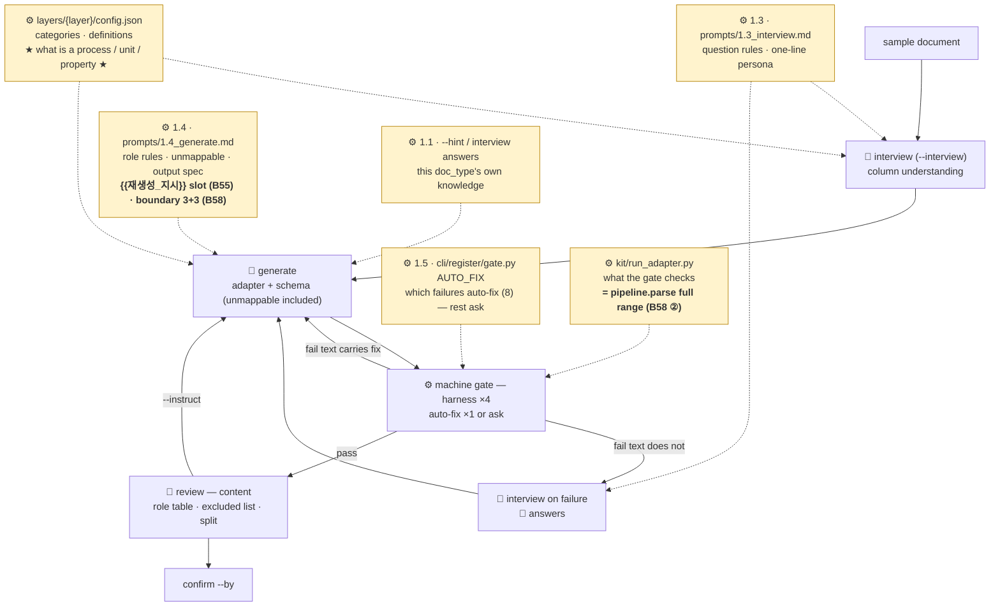
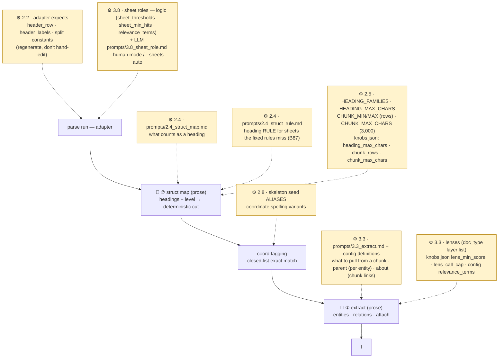
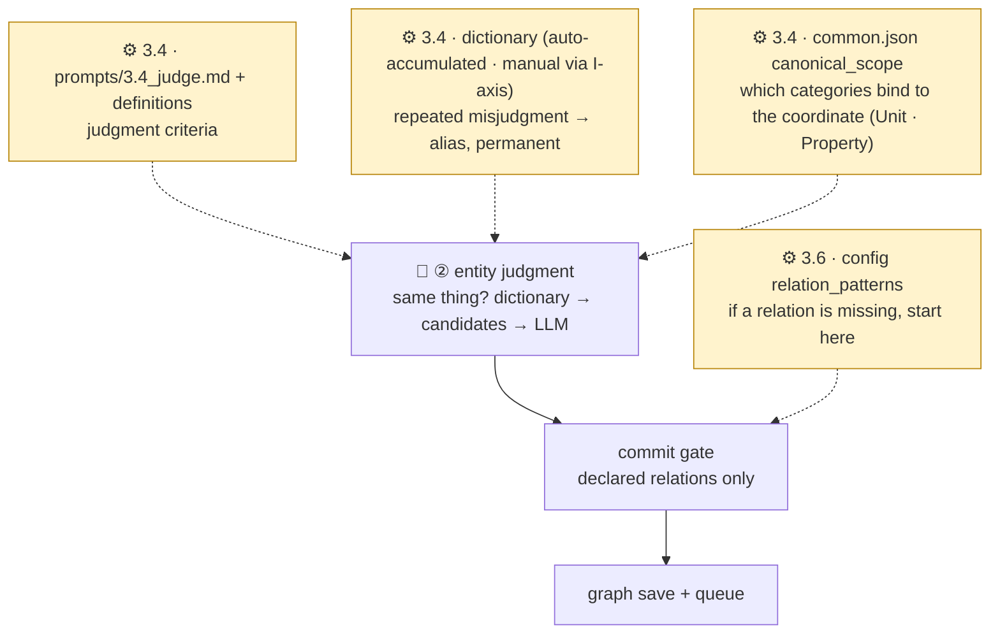
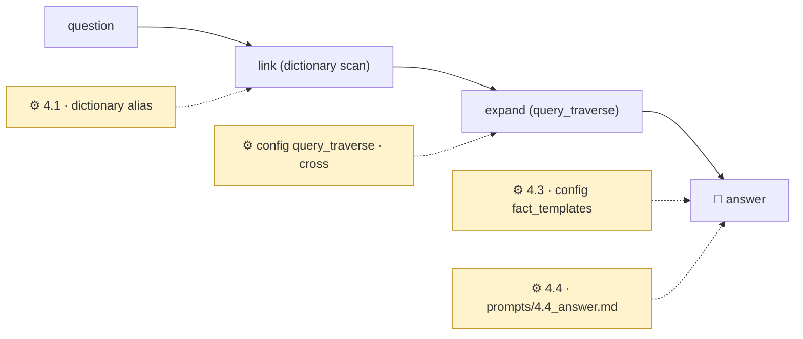

# 05 · 조절 지도 — 흐름 위에서, 어느 단계의 어떤 판단을 어느 자산이 만드나

> ← `04_질의` · 참조 `09_부품_해설`
> **독자**: 운영자. LLM의 판단이 아쉬울 때 "흐름의 어디서 잘못됐고, 그 자리를 만드는 자산이 무엇인지"를 찾는 지도다. **B48(⑦ 지시문)·B49(unmappable)·B50(AUTO_FIX·문답)·B55(문답 누적·지시 템플릿)·B58(재등록·관문 범위) 배지를 더했다.**
> **손잡이는 `00_칸_대장.md`의 칸 ID로 부른다**(B63) — 그림의 P/Q/R은 그리기용 노드 이름일 뿐이고 라벨 머리의 숫자가 칸이다.
> **재고 목록은 `06_손잡이_대장.md`** — 여기는 증상에서 자리를 찾는 지도이고, 손잡이 전체(config 키·상수·설정 포함)는 06이 한 장으로 갖는다.
> **여기 없는 것**: 계기판·골든셋은 *판단을 만드는 자산*이 아니라 *측정 장치*라 이 지도의 대상이 아니다 — 04 「확인 루틴」과 가이드 §5.4를 본다.
> **읽는 법**: ⚙배지가 **사람이 조절하는 자산**이다. 배지가 꽂힌 단계의 판단만 그 자산이 바꾼다 — 다른 단계는 안 변한다.
> **판단 기준 지도**(B112 ⑧ — 아래 질의 흐름 뒤): 판단마다(시트 역할 · 분할 · 좌표 · 추출 개체 · 소속 · 관계 · 판정 · 다른 공정 이름 · 빈칸 표시 · 부착 · 재연결 · 질의) 규칙이 사는 자리 다섯 — 지시문 · 규약 번호 / config 키 / 코드 함수 / 손잡이 / 화면에서 보이는 줄. 코드에서 뽑았다.

## 등록 흐름 (doc_type 1회) — 판단이 제일 많은 곳

**★ 「뭐가 공정 정보인지 모른다」는 config 정의문 자리다.** 정의문이 판정 프롬프트로 조립되어 문답·생성·**추출** 셋에 들어간다 — 정의문이 교과서 문장이면 판정도 교과서 수준이다. `config작성_가이드.md` §9의 정의문 프롬프트로 사내 LLM에서 초안을 뜬다.

**뺀 열이 또 뜬다** → 템플릿(1.4)이 아니라 **스키마 `unmappable`**이 비어 있는 것이다(구판 등록분). `generate --resume`으로 스키마만 다시 뽑으면 `excluded`/`undecided`가 갈린다.

## 파싱·추출 흐름 (문서마다) — 형태와 의미

## 구축 흐름 (문서마다) — 판정·해소의 자리

## 질의 흐름

## 판단 기준 지도 — 판단마다 규칙의 자리 (B112 ⑧)

「왜 이렇게 됐나」를 물을 때 그 판단의 규칙이 어디에 적혀 있나. **지시문**은 LLM이 읽는 규칙(파일 · 규약 번호 — 파일이 정본) · **config**는 층 · 공통 config의 키(데이터 — 코드에 층 어휘 0) · **코드**는 그 판단을 내리는 함수(하나 — 화면과 대장이 같은 함수를 지난다) · **바꾸면 다시 도는 범위**는 그 자리를 고친 뒤 무엇을 다시 돌려야 하나(`core/state/config_scope`의 갈래 — 추출 입력이면 추출 다시 · 게이트 · 구축이면 재구축 LLM 0 · `bootstrap` 끝 줄이 칸과 문서 수를 말한다) · **손잡이**는 사내가 바꾸는 값(`$ONTO_HOME/knobs.json`의 닫힌 키 · 플래그 · 기록 파일) · **화면**은 그 판단이 보이는 줄. 칸은 `00_칸_대장.md`.

| 판단(칸) | 지시문 · 규약 | config 키 | 코드 함수 | 손잡이 | 화면에서 보이는 줄 | 바꾸면 다시 도는 범위 |
|---|---|---|---|---|---|---|
| **시트 역할**(3.8) — 산문 엑셀의 시트마다 prose · ref · skip | `prompts/3.8_sheet_role.md` 판정 규약 1~5(정의문 대상을 서술하면 prose · 짧은 항목 줄은 ref · 모르면 ref · skip은 고르지 않는다) — 지점 ⑩ `core/llm/points.judge_sheet` | 렌즈 층의 정의문 · `relevance_terms` | 리더 `parser/reader.read`(시트 상태 — 숨김 · 아주 숨김) → 로직 `parser/form.sheet_table`(모양 + 층 어휘 적중 · 숨김은 skip) → 두 제안 `cli/sheet_gate.judge`(같으면 그것 · 어긋나면 ref · 숨김 · 빈 시트는 LLM 0) | knobs `sheet_thresholds` · `sheet_min_hits` · 플래그 `--sheets "<번호>:<역할>"` · `--sheets auto` · 기록 `registry/sheet_roles/<doc_id>.json` | `■ 시트 역할` 표(숨김 · 로직 · LLM · 제안) · `시트 역할 — 기록대로 진행(…)` · `▶ 다시 고르려면` · `시트별 조각 — …` | 시트 역할을 고치면(`--sheets`) 그 문서를 다시 넣는다(그 시트 추출 다시) · 정의문은 추출 다시 |
| **분할**(2.4 · 2.5) — 제목 · 레벨 · 청크 경계 | `prompts/2.4_struct_map.md`(무엇이 제목인가) · `prompts/2.4_struct_rule.md`(고정 규칙이 못 세운 시트의 제목 규칙) — `core/llm/struct_map_pass` | 어댑터 분할 상수(칸 2.2 — 재생성으로) | `parser/struct_map.apply`(제안 → 검사 → `choose_level` → `split` → 글자 상한 `cap_chars`) · 상수 `HEADING_FAMILIES` · `HEADING_MAX_CHARS` 60 · `CHUNK_MIN`/`CHUNK_MAX` 5/40행 · `CHUNK_MAX_CHARS` 3,000 | knobs `heading_max_chars` · `chunk_rows` · `chunk_max_chars` | 등록 `분할 — <시트> …` · `계층 규칙 — …` · `글자 상한 초과 n청크 → …` · 청크 목차의 라벨 | 어댑터 상수 · 지시문 — 재등록 → 파싱 · 추출 다시 |
| **좌표**(2.8) — 조각이 어느 공정의 것인가 | `prompts/2.8_coord_tag.md`(닫힌 목록에서 고르거나 null) — 지점 ⑨ `core/llm/points.pick_coord` | 좌표 층 골격 seed `ALIASES` · 공통 config(좌표 층 = `Process`의 집 — `core/state/bootstrap.coord_layer`) | `parser/tagger.tag`(골격 → 좌표 학습 기록 → 목록 밖 기억 → LLM) · `coord_from_section`(시트명 · 제목 — 문서 좌표 서브트리 안) · 문서 좌표 `suggest_doc_coord`(파일명 조각이 노드 하나에 정확히 맞을 때만) · `inherit_doc_coord` · 쌍 `parser/coord_pairs.verdict` | 플래그 `--coord <골격 이름>` · `--coord-llm`(태깅 상한) · knobs `coord_pair_pct` · `skeleton_column_pct` · 기록 `registry/doc_coords.json` · `data/coord_learned.json` | `문서 좌표 — X (출처: …)` · `좌표 태깅 — …` · `좌표 — 조각 N · 자기 …` · `좌표 쌍 — …` · 맞춤 `조각 좌표 N = …` · `문서 좌표 없음 — …` + 가까운 골격 이름 | seed `ALIASES` — `bootstrap` → 재연결(`ops relink` · LLM 0) 또는 재구축 |
| **문서 구조**(2.4 · 2.5 · 3.3) — 제목 줄의 단 · 역할(대상 · 묶음 · 주제 — 층 중립) · 대상 · 청크 구간 | `prompts/3.3_outline.md` o-2.0 1~7(제목 줄만 · 부모는 앞 줄 · 되풀이 소제목은 유닛의 자식 · 대상 이름은 줄 글자 그대로 · 닫힌 카테고리 · 애매해도 역할을 고른다) — 지점 ⑪ 태그 `structure`(산문 시트마다 무조건 · `core/build/structure.structurer`) · 구조 없는 제목만 `outline._ask`(슬라이드 · 쪽) | 층 `categories` 정의문(유닛 정의문 — config작성_가이드 §1-b) | 이름표 `parser/struct_rule.labels`(고정 규칙 = 초안) → 검사 `structure.check`(줄 밖 · 역할 밖 · 앞에 없는 부모 → 초안 · 글자 밖 이름 · 목록 밖 카테고리 → 대상 버림) → 보존 `work/struct_maps/<doc_id>.json`의 `structure` → 사람 고침 `apply_fixes` → 분할 `frame_chunks`(설비 · 유닛 · 사양 묶음 아래에서 자른다) → 조각 `meta.structure` → 개요 `outline.run`(LLM 0) · 추출 입력 `structure_chain` · 이름 `naming.name_parent` | 기록 `registry/structure_fixes.json` · mock 힌트 `<doc_id>@structure.json` · knobs `chunk_rows` | `구조 — 시트 n · 제목 m(역할별) · LLM 호출 k · 재사용 r` · `[약한 구조] …` · `--step` 구조 표 · 맞춤 `구조(역할)` · `구조 · 다른 공정 가드` | 정의문 · 지시문 판 — 구조 · 추출 다시 · 사람 고침 — 그 문서 다시 파싱(LLM 0) |
| **추출 개체**(3.3) — 청크에서 무엇을 뽑나 | `prompts/3.3_extract.md` 추출 규약 1~3(주제로 서술하는 개체만 · 정의문 밖은 내지 않는다 · 애매하면 뺀다) · 9(겸) — 판 `core/build/extract.prompt_version` | 층 `categories` 정의문 · `relevance_terms`(렌즈 거름) | `core/build/extract.extract`(계획 → 청크마다 → 체크포인트 `_write_checkpoint` 하나) · 맥락 줄 `core/build/extract_ctx.with_context` · 라벨 `chunk_label` · 렌즈 `core/build/lens` | knobs `lens_min_score` · `lens_call_cap` · 재사용 조건(문서 해시 · 어댑터 판 · 지시문 판 · 층 config 판 = 추출 칸 해시 `config_scope.extract_key` · 개요의 대상 제목) | `추출 예고` + 청크 목차 · 추출 표 · `추출 끝` + `개체 0 청크` 목록 · `추출 체크포인트 — … (있음)` · 맞춤 `청크(산문) N = …` | 정의문 · 관계 이름 · `relevance_terms` · `value_categories`(추출 입력) — 추출 다시(판은 자동 — 추출 칸 해시) |
| **소속**(3.4) — 개체가 무엇의 일부 · 특성인가 | `prompts/3.3_extract.md` 규약 5(개체마다 `belongs_to` · 이름은 넷에서만 — 부착 후보 · 본문 · 맥락 줄 · 제목 개체 `heading_candidates` · 본문이 말하지 않으면 가장 가까운 제목 개체 · 근거가 없으면 null — 지어내지 않는다 · 판 e-1.6) · 7(개체별 부모) | 공통 `canonical_scope.bind_categories` · `nest_categories`(이름에 소속) · 층 `category_pair_map`(소속 엣지의 관계 · 방향) | `core/build/belongs.source_of`(본문 · 경로 · 시트 · 공정에 있는 이름만 — 없으면 `drop_invented`) · `resolve_target` · `edge_of`(카테고리쌍 두 방향) · `core/build/prose._belongs_edges` | — (config) | 값 표 `└ <표기> · <관계> <→\|←> <상대> (소속(<출처>))`(화살표 = 실제 엣지 방향) · 맞춤 `소속 대상(소속을 낸 개체) N = …` · `show report --trace`의 `소속 '<이름>' → <대상>(<종류>) → <결과>` · `소속 없음 비율` | `canonical_scope`(구축) — 재구축 LLM 0 · 지시문 판 — 추출 다시 |
| **관계**(3.6) — 어떤 삼항이 그래프에 서나 | `prompts/3.3_extract.md` 규약 4(닫힌 목록에서 고른다 · 못 고르면 비운다) | 층 `relation_patterns` · 표는 스키마 `edges` | `core/build/gate.judge` → `commit_edge`(선언된 삼항만) · 거부 `log_reject` | — (config) | `관계 버림(관문) — …` · 맞춤 `부착(개체 행)`의 `관계만` · 거부 기록 `work/gate_rejects.json` | `relation_patterns`(게이트) — 재구축 LLM 0(`bootstrap` 끝 줄 · `show log gate --by-pattern`) |
| **판정**(3.4) — 같은 것인가 · 새 것인가 | `prompts/3.4_judge.md` 규칙 1~5(확신 없으면 uncertain · 후보 안의 id만 · 표기 변형이지 유사 개념이 아니다 · 부착 위치를 본다 · auto 주의) · 층 config `prompts.judge` 덧붙임 | 정의문 · `match_threshold` · 공통 `canonical_scope` | `core/matcher.resolve`(골격 · 사전 `dict_hits` → 후보 `candidates` → 좁힘 `_narrow` → 판정 `match`) · `core/build/build.Builder.resolve_entity` · 재생 `core/build/replay` · 기억(`memo`) | 상수 `CANDIDATE_TOP_N` 12 · 플래그 `--narrow embed\|overlap` · `--no-replay` · 사전 `data/dictionary.json` | `판정 예고 — …` · 값 표 · `판정 — 호출 k · 사전 h · …` · `판정 재생 — …` · 맞춤 `값(개체 행) N = …` · `결말(개체 행)` | `canonical_scope` — 재구축 LLM 0 · `match_threshold` — 다음 인입부터(재구축은 판정 재생) |
| **부착**(3.4 규칙 B) — 어디에도 안 붙은 개체를 어디에 | — | 층 `category_pair_map`(제목 개체 · 좌표 → 개체 관계 · 방향) | `core/build/loop.fallback_untouched` → **폴백 사슬**(B115 ③ — 그 청크 위의 제목 개체 가까운 것부터 `_chain_attach` · 카테고리쌍 매핑이 있는 첫 칸 · 대장 `폴백(제목 n단)`) → `_fallback_attach`(끝까지 없으면 그 좌표에 · 매핑이 없으면 결함 로그) · 제목 개체 자신은 `core/build/heading.land`(트리 엣지 → 없으면 같은 사슬) · 표 `core/build/table._row_fallback`(제목 없음 — 좌표만) | — (config · 문서 개요) | `── [7/8] 부착·엣지 — 엣지 +n · 저해상도 부착 r행 · 제목 개체 폴백 h행`(붙인 것만) · 값 표 `└ … (폴백(제목 n단))` · 맞춤 `부착(개체 행) N = … + 제목 폴백(n단) + 좌표 폴백 + …` · `엣지 없는 노드 n` + 사유 | `category_pair_map`(구축) — 재구축 LLM 0 |
| **연결 보강**(3.4) — 재연결 뒤에도 엣지 없는 · 공정에만 붙은 개체를 무엇에 | `prompts/3.4_reinforce.md` 1~4(후보 밖 id 0 · 근거 문장은 청크 원문 그대로 · 관계는 닫힌 목록 또는 null · 애매하면 고르지 않는다) — 지점 ⑫ `core/build/reinforce._ask` · 판 rf-1.0 | 층 `relations` · `relation_patterns`(게이트) · `category_pair_map`(관계를 안 냈을 때) | `core/build/reinforce.run`(마무리 `entry.finalize`의 재연결 뒤 · 이 실행의 문서만) → 대상 `targets`(엣지 0 · 골격 좌표에만) → 후보 `candidates`(같은 문서 · 그 청크의 맨 위 제목 서브트리 · 가까운 것부터 `CAND_MAX` 30) → 재생 `_prior`(지난 `link` 행 — LLM 0) → 판정 → 대조 `_check` → 엣지 `_connect`(관계를 냈으면 게이트가 받는 방향 · 아니면 매핑 두 방향) → 대장 `link` 행 | knobs `reinforce_call_cap`(실행당 호출 · 0 = 끔) · `--no-replay`(재생 끔) | `연결 보강 예고 — 대상 n → LLM ≤ k회` · `i/n <표기> — <관계> <→\|←> <상대>` · `[마무리]`의 `연결 보강 — 대상 n → 붙음 · 재생 · 못 고름 · 버림 · 호출` · 맞춤 `부착(개체 행)`의 `연결 보강` · `show report`의 `연결 보강(대상 개체) N = …` | `relation_patterns` — 재구축 LLM 0(버림은 그 제안을 지금 config로 다시 돈다) |
| **다른 공정 이름**(3.4) — 좌표 계보 밖 골격 이름을 만났을 때 | `prompts/3.3_extract.md` 규약 10(청크 좌표가 아닌 다른 공정의 이름은 개체로 내지 않고 관련 링크로) — 판 e-1.5(지금 e-1.6) | 좌표 층 골격 seed(이름 · `ALIASES` — 데이터) | 공통 자리 `core/build/build.Builder.resolve_at_home` → `other_process`(사전에서 골격 노드 · 좌표 노드의 조상 ∪ 서브트리 밖이면 노드 0 · 좌표가 없으면 가드 없음) → `_mention` · 관련 링크 `core/build/loop.link_mentions`(청크 → 그 공정 노드 · `chunks.json`의 `about` · 표는 그 행의 내용 칸 청크) — 표 · 산문 · 렌즈 한 자리 | — (골격 · 문서 좌표 `--coord`) | 값 표 `mention · 다른 공정 · 관련 링크 <공정>` · 맞춤 `값(개체 행)`의 `다른 공정 언급` · `부착(개체 행)`의 `관련 링크` | 골격 seed — `bootstrap` → 재구축 |
| **빈칸 표시**(3.2 · 2.8) — `-` · `N/A` · `해당 없음`은 값인가 | `prompts/3.3_extract.md`(개체 표기 — 결과를 대조한다) | 공통 config `null_markers`(닫힌 목록 · 없으면 기본 8) | `parser/normalizer.null_marker`(한 함수 · 공백 무시) — 표 좌표 칸 `blank_coords`(파싱 · 비우면 문서 좌표) · 표 개체 칸 `core/build/table`(개체 0) · 값 칸(원문 + 대장 `blank` 표지) · 산문 `core/build/prose._pass1_entities`(개체 · 소속 이름) — 목록 주입 `core/paths.bind_parser` | 공통 config `null_markers` | 맞춤 `조각 좌표 … (빈칸 표시로 비움 n — 합 밖)` · `값(개체 행)` · `부착(개체 행)`의 `빈칸 표시` · 값 표 `blank` | `null_markers` — 그 뒤에 넣는 문서부터(이미 넣은 문서는 다시 넣는다) |
| **재연결**(3.5) — 못 붙은 것을 언제 다시 | — | — | `core/build/retry.retry_orphans`(대상 `is_target` — `RETRY_KINDS` 셋 + 좌표 미해소 보류 `missing_field`(재료를 든 것) · 바퀴 `_sweep`를 붙음 0까지 · 지문 `_fingerprint` = 층마다 노드 · 엣지 수 + 골격 · 사전 · 좌표 학습 판(`_material_print`) — 보류는 그 문서의 문서 좌표 기록까지(`_item_fp`) · 같으면 건너뜀 · `ATTEMPT_MAX` 5) — 인입 끝 마무리 `core/build/entry.finalize` · 손 명령 `cli/ops._relink`가 같은 함수를 부른다 · 보류 행은 `_retry_coord_hold`(재료로 다시 세움 · 추출 LLM 0) · 소속 미해소는 `belongs.edge_of`(두 방향) | knobs `relink_rounds`(바퀴 상한 · 기본 5) · `ops relink all [--doc <id> --coord <골격 이름>] --actor <이름> [--apply]` · 골격 `ALIASES` · 노드(판이 바뀐다) | `── [마무리] — 미러 · 재시도 · 연결 보강` 아래 `재연결 — 바퀴 k · 대상 n · 붙음 m · 남음 r(사유별) · … 건너뜀 s · 상한 도달 c` · 손 명령은 바퀴마다 `바퀴 i — 대상 · 붙음 · 건너뜀 · 상한` | 손잡이 `relink_rounds` — 다음 인입 마무리 · `ops relink` |
| **질의**(4.1 · 4.3 · 4.4) — 무엇을 근거로 무엇을 답하나 | `prompts/4.1_link.md` 1~3(후보 밖 id 0 · 애매하면 고르지 않는다 · 이유 한 줄) · `prompts/4.4_answer.md` 1~4(그래프 사실 먼저 · 근거 번호 · 근거 밖은 모른다 · 무관한 것은 버린다) | 층 `query_traverse` · `fact_templates` | `core/query/query.link`(사전 → 임베딩 후보 `core/query/hybrid.link_candidates` + LLM 선별 `_link_llm`) · `expand` · `facts` · 문서 검색 `hybrid.doc_search`(임베딩 문턱 + BM25) | knobs `query_link_top_k` · `query_link_mode` · `query_doc_top_k` · `query_doc_min_sim` · `collect_limit` · `ref_limit` · `query_record_limit` | 질의 ⓐ~ⓖ(링크 결과 · 근거 · 답 · 쓴 근거 · 원 레코드) | `query_traverse` · `fact_templates` — 즉시(다음 질의부터 · 재구축 없음) |

## 등록 단계 LLM 호출 셋 — 무엇을 보내고, 판단은 어디 사나 (B62 ② 이후)

등록에서 LLM을 부르는 자리는 셋(칸 1.3 · 1.4)이고, 셋 다 `review/<doc_type>/input_package.json`을 읽는다. **판단의 정본은 `input_package.json`**(`decisions[]`), **대화의 이력은 `interview_log.json`**(라운드 전문) — 둘은 묶음 `at`으로 짝을 맞춘다. `state.json`은 실행 장부(어댑터 경로·revision·지시 이력·마지막 관문 출력)이지 판단이 아니다.

| Call | Cell | System prompt | User message | Full rounds sent? |
|---|---|---|---|---|
| 초안·재생성 (`draft`) | 1.4 | 생성 템플릿 — `[확정 사항]`만 렌더(B60 ②) | `input_package.json` 원문 — 이제 decisions만 담는다 | No (B62 ②: 라운드 30개 더해도 36,418B 그대로) |
| 문답 라운드 | 1.3 | `prompts/1.3_interview.md` + role·층 어휘 발췌 | `{입력_패키지, 지난_문답: 현재 묶음의 라운드(로그)}` | 현재 묶음만 · 이전 표본 전문은 안 보낸다(판단은 decisions로) |
| 문답 확정 요약 | 1.3 | `prompts/1.3_interview.md` | `{입력_패키지, 문답_전문: history}` | Yes — 요약이 목적이라 이 호출만 |

- 조립된 지시문 실물: `ONTO_DUMP_PROMPT=1`이면 `work/register/<doc_type>/prompt_rendered.md`. 프롬프트가 무엇을 받는지는 코드가 아니라 **이 파일을 열어** 본다. `_sent_size`가 호출마다 전송량을 찍는다.
- 템플릿은 `prompts/1.4_generate.md` 하나(B63 ① — 옛 판은 `git show 9f58ec9:kit/…`).

## 증상 → 자리 (요약표)

| Symptom | Stage | Asset | Takes effect |
|---|---|---|---|
| 뭐가 공정/설비/관리항목인지 모른다 | 등록·문답/생성 · 추출 | **config 정의문 (config — 칸 1.4·3.3·3.4가 읽는다)** | 다음 등록·다음 추출부터 |
| 문답 질문이 빗나간다 | 등록·문답 | `prompts/1.3_interview.md` (칸 1.3) | 다음 문답부터 |
| role 배정·출력 형식이 이상하다 | 등록·생성 | 템플릿 (칸 1.4) — 판 올려서 | 다음 생성부터 |
| 이 문서만 특이하다 | 등록·생성 | 힌트/문답 (칸 1.1) | 그 등록 1회 |
| **뺀 열을 또 묻는다** | 등록·검수 | 스키마 `unmappable` 비어 있음 → `--resume` | 그 doc_type |
| **어떤 하네스 실패가 자동으로 안 풀리고 매번 묻는다** | 등록·관문 | `AUTO_FIX` (칸 1.5) — 문면이 답을 담는 실패면 추가 | 다음 생성부터 |
| **양식 표류가 뜬다** | 파싱·preflight | 어댑터 `expects` (칸 2.2). **확정 전이면** `review --instruct`, **확정된 doc_type이면** `generate --revise`(B58 ①) | 그 doc_type |
| **등록된 doc_type을 고치려는데 「이름 중복」으로 막힌다** | 등록 | `generate --revise`(같은 이름 새 판 · 승인 이력 누적) 또는 `--as <새이름>`(변형 등록). 플래그 없이 부르면 화면이 두 경로를 적어 준다 | 그 doc_type · 옛 판으로 인입된 문서는 **자동으로 다시 안 읽는다** |
| **관문은 통과했는데 검수에서 기계 오류가 난다** | 등록·관문 | 있으면 안 되는 상태다(B58 ② 이후) — 관문이 `pipeline.parse` 전 구간을 돌므로 **남으면 그것이 결함**이다. 재현 절차와 함께 허브로 | — |
| **재생성 지시를 줬는데 초안이 안 바뀐다** | 등록·생성 | 지시는 템플릿 `{{재생성_지시}}` 자리로 조립된다(B55). `ONTO_DUMP_PROMPT=1`로 전송분을 열어 지시가 실렸는지부터 본다 | 그 생성 1회 |
| **산문 청크가 통째로 나온다 / 제목을 못 나눈다** | 파싱·⑦ | `prompts/2.4_struct_map.md` (칸 2.4) · `source: heuristic`이면 게이트웨이 설정 | 다음 인입부터 |
| 좌표를 못 알아본다 | 파싱·태깅 | 골격 ALIASES (칸 2.8) → `bootstrap` | bootstrap 후 |
| **청크에서 엉뚱한 것을 뽑는다 / 안 뽑는다** | 추출 | `prompts/3.3_extract.md` + 정의문 (칸 3.3). `show extract`로 확인 → `cli.extract --force` | 재추출부터 |
| 같은 것을 딴 것으로 (또는 반대) | 구축·판정 | `prompts/3.4_judge.md`·정의문 (칸 3.4) · 반복이면 사전 (칸 3.4) | 다음 인입부터 |
| 노칭의 커터와 탭용접의 커터가 한 노드다 | 구축·해소 | 공통 config `layers/common.json::canonical_scope.bind_categories` (칸 3.4) → 재인입 | `init --fresh` 후 전량 |
| 층이 겹친 카테고리가 두 노드로 갈렸다 · 스테이션 아래 「… unit」이 새 Unit이 됐다 | 구축·해소 | 공통 config `home`(집 하나) · `also`(겸 — 스테이션 단) + 골격 `ALIASES` (칸 0.1) → `bootstrap` → 재인입 | 다음 인입부터 |
| 관계가 그래프에 없다 | 구축·게이트 | `relation_patterns` (칸 3.6) — `gate_rejects.json` 먼저 | 다음 인입부터 |
| 답이 특정 표기를 못 찾는다 | 질의·링킹 | 사전 alias (칸 4.1) | 즉시 |
| 답의 사실 문장이 어색하다 | 질의·수집 | `fact_templates` (칸 4.3) | 즉시 |

## 자산의 자리는 지위다

| Location | Status | Examples |
|---|---|---|
| `kit/` | 반출 전달물 — 등록 세션이 읽는다 | 생성 템플릿 · 스켈레톤 · 참조 어댑터 · 하네스 · 렌더러 |
| `prompts/` | LLM 지시문 9개 — **파일이 정본**(§7.6-B-5) · `<칸ID>_<이름>.md` · 집합 == 칸 대장(회귀 잠금) | 1.3 문답 · 1.4 생성 · 2.4 구조지도 · 2.8 좌표·이미지 · 3.3 추출 · 3.4 판정 · 4.1 링킹 · 4.4 답변 |
| `layers/{층}/` | 층 자산 | `config.json` · `skeleton.json` |
| `schemas/` · `adapters/` | doc_type 자산 — **confirm이 놓는다** | 손으로 고치지 않는다 |
| `data/dictionary.json` | 축적 지식 — 자동 + I축 수동 | |

합치지 않는다. 한 화면에 모으는 것은 플랫폼 몫.

## 원칙 셋

1. **지식은 페르소나 문장이 아니라 검증 가능한 데이터로** — 정의문·골격·사전·문답 네 그릇.
2. **문답에서 한 답 중 반복될 유형은 정의문으로 승격하라** — 다음 등록부터는 안 묻는다.
3. **어댑터·스키마는 손으로 고치지 않는다** — 재생성으로 고친다. 재생성분도 기계 관문을 지난다([정정] 40). **두 경로가 다르다**: 확정 전 세션 안에서는 `review --instruct`, **이미 확정된 doc_type은 `generate --revise`**(B58 ① — `revision`이 오르고 승인 이력이 누적된다).
